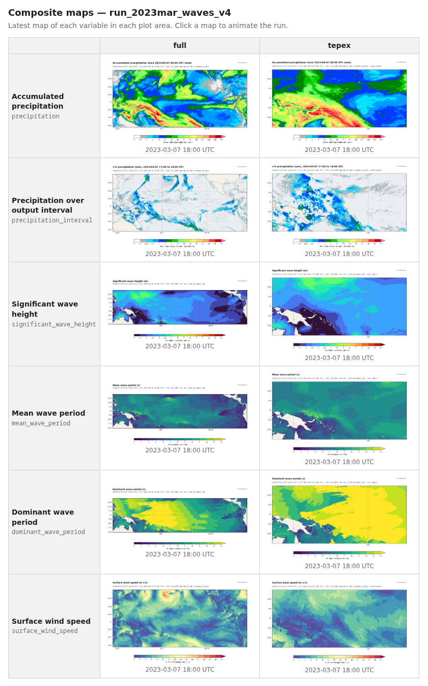

# ModelAtlasify

ModelAtlasify turns numerical model output into **discoverable, geospatially
standardized assets**. It reads a model's native files and produces:

- Cloud-Optimized GeoTIFFs in the model's native map projection,
- quick-look PNG maps,
- a [STAC](https://stacspec.org) catalog that describes the model run, its
  domains, its valid times, and every generated asset.

The goal is to make model output usable by GIS and data-analysis tools, not just
to plot it. STAC is the interoperability layer: anything that reads STAC
(QGIS, pystac-client, stac-browser, odc-stac, ...) can find and load the
products.

This repository is an early working version: WRF atmosphere output and DWM
wave model output (on its own or coupled, e.g. UWIN-CM), run from the command
line.

## Current capabilities

- **WRF** atmosphere-only history output (`wrfout_d<NN>_<YYYY-MM-DD_HH:MM:SS>`),
  multiple files, multiple times per file, multiple domains, and multiple run
  directories in one call
- **Moving nests** (e.g. vortex-following d02/d03): each valid time is placed
  where the nest actually was, using that time's XLAT/XLONG. This applies to the
  GeoTIFF georeferencing, the per-item maps, the STAC Item geometry/bbox and
  `proj:*` fields, and the composite maps. Interval precipitation is
  differenced at the same location, not the same array index. Cells that
  entered the nest during the interval are missing.
- **DWM** (Donelan Wave Model, formerly UMWM) wave model output
  (`output/umwmout_<YYYY-MM-DD_HH:MM:SS>[.nc]`; the files keep the old name), on
  its own or inside a coupled run directory. It is used automatically whenever
  that output exists. Valid times come from the file names. The grid is
  recovered from the files' lon/lat: Mercator, regular lon/lat, or the map
  projection of the run's WRF output (e.g. Lambert conformal). If none fits,
  it is resampled onto a regular lon/lat grid, with a warning (see
  [DWM grids](#dwm-grids)). The start time comes from `namelists/main.nml`
  when present.
- **Surface wind** (10 m), in m s-1: speed, plus earth-relative eastward and
  northward components (`u10`, `v10`, GeoTIFFs only). Speed maps show wind
  vectors on the composites and the per-item maps
- **2 m temperature** (`t2m`), in degC, with 10 m wind vectors on its maps
- **Precipitation**, in mm:
  - accumulated since the start of the domain's integration
  - accumulated over each output interval
- **Outgoing longwave radiation** (WRF, when the output has `OLR`), in W m-2:
  GeoTIFFs of the full field (`olr`), and maps of OLR in reversed greyscale
  with the interval precipitation drawn on top (`olr_precipitation`)
- **Sea spray** (WRF in UWIN-CM runs with spray on): spray mass flux
  (kg m-2 s-1, logarithmic colour scale), spray-mediated latent and sensible
  heat flux (W m-2)
- **Waves** (DWM): significant wave height (m), mean wave period (s), dominant
  wave period (s). Land is missing.
- **GeoTIFF** output (COG, float32, NaN nodata, CRS + affine transform, units and
  provenance tags)
- **PNG maps** in the native projection
- **STAC catalog generation** (Catalog → Collection per run → Item per domain
  and valid time), validated against the STAC JSON schemas
- **Output to S3**: `-o s3://bucket/prefix` writes everything straight to the
  bucket (see [Output to S3](#output-to-s3))
- **Interactive CLI**: runs, reports progress, and exits

## Install

The environment is managed with [Pixi](https://pixi.sh). The conda-forge
packages keep the GDAL/PROJ/GEOS binaries consistent.

The instructions to install Pixi if you don't already have it are [here](https://pixi.prefix.dev/latest/installation/).

```bash
git clone <this repo> modelatlasify
cd modelatlasify
pixi install          # creates .pixi/ with all dependencies + modelatlasify (editable)
pixi run test         # run the test suite
```

You can either run commands through `pixi run ...` or activate the environment
with `pixi shell`.

Without Pixi, `pip install -e .` works in any environment that already has
GDAL-backed `rasterio`, `cartopy`, and `netCDF4`. Add `jsonschema` if you want
STAC validation.

## Example

```bash
pixi run modelatlasify /data/wrf/run01 --output ./atlas -np 8
```

```text
ModelAtlasify 0.1.0: all models found -> /home/me/atlas
Variables: surface_wind_speed, precipitation, precipitation_interval (8 processes)
Found WRF run 'data/wrf/run01' in /data/wrf/run01:
  d01: 25 file(s), 25 time(s) 2026-10-06 00:00 -> 2026-10-07 00:00 UTC, 1649x699 grid, georeference fit error 2.4 m.
run01 d01: 100%|██████████████████████████████| 25/25 [00:06<00:00,  3.9time/s]
Generated 25 STAC items, 74 GeoTIFFs, 74 maps, 74 composite maps in 31 s.
Checking catalog links and validating STAC schemas...
STAC validation passed for 27 objects; all asset links resolve.
/home/me/atlas/catalog.json
```

Resulting layout. Each run's output goes under the output directory at its input
directory's full path, here `data/wrf/run01/`; `--cut-dirs` shortens that:

```text
atlas/
├── catalog.json                              # STAC Catalog (root)
└── data/wrf/run01/                           # one directory per model run (mirrors the input path)
    ├── collection.json                       # STAC Collection: the run
    ├── command-used.20261012T153045Z.txt     # the exact command, one file per invocation
    ├── model-images.html                     # table of latest maps, linking to the animations
    ├── model-images/                         # composite maps (not in the STAC catalog)
    │   ├── full/                             # plot area: the whole outermost domain
    │   │   ├── precipitation.html            # animation of precipitation/ (open in a browser)
    │   │   ├── precipitation/
    │   │   │   └── uwincm.full.precipitation.20261006T010000Z.png
    │   │   ├── precipitation_interval/
    │   │   ├── olr_precipitation/            # OLR with interval precipitation on top
    │   │   ├── t2m/                          # 2 m temperature with wind vectors
    │   │   └── surface_wind_speed/
    │   └── gulf/                             # a --plot-sub-areas area (lon/lat map)
    │       └── precipitation/ ...            #   uwincm.gulf.precipitation.<time>.png
    └── items/
        ├── d01-20261006T000000Z/
        │   ├── d01-20261006T000000Z.json     # STAC Item: domain d01 @ valid time
        │   ├── surface_wind_speed.tif
        │   ├── surface_wind_speed.png        # with wind vectors
        │   ├── u10.tif, v10.tif              # earth-relative 10 m wind components
        │   ├── t2m.tif / .png                # 2 m temperature (map with wind vectors)
        │   ├── precipitation.tif
        │   └── precipitation.png
        └── d01-20261006T010000Z/
            ├── d01-20261006T010000Z.json
            ├── surface_wind_speed.tif / .png
            ├── precipitation.tif / .png
            ├── precipitation_interval.tif / .png
            ├── olr.tif                       # OLR data (no map of its own)
            └── olr_precipitation.png         # map: OLR with interval precipitation
```

Besides the per-domain map of each STAC item, `model-images/` holds one
composite map per valid time and variable: the outermost domain (d01) with any
nested domains (d02, d03, ...) drawn on top at their own resolution and outlined
in black. A nest is overlaid only when its product covers the same period as
d01's (e.g. not when it started accumulating precipitation later). Otherwise
only its outline is drawn.

Next to each variable's folder, `<variable>.html` (e.g.
`model-images/full/surface_wind_speed.html`) plays that folder's maps as a
looping animation, with play/pause, step and speed controls and a time slider.
`model-images.html`, next to `model-images/`, is the place to start: a table
with one row per variable and one column per plot area, showing the latest map
of each. Click a map to open its animation. These pages are self-contained, so
they work when opened straight from disk.



*`model-images.html` for a coupled WRF + DWM (UWIN-CM) run, with the whole
domain (`full`) and a `--plot-sub-areas` box (`tepex`).
[Live example](https://orca.atmos.washington.edu/~bkerns/atlas/home/disk/orca/ckub/models/uwincm/run_2023mar_waves_v4/model-images.html).*

Each model gets its own composites in the same folders: wave maps (e.g.
`model-images/full/significant_wave_height/`) cover the wave model's domain, not
the atmosphere's. On a Mercator wave grid the domain edge is drawn as a dashed
black line. Any other wave grid (e.g. Lambert) is drawn in PlateCarree, in a
lon/lat box 1° larger than the domain on every side, with its edge outlined in
solid black like the WRF domains.

With `--plot-sub-areas`, the same composites are also made for named lon/lat
boxes, drawn in PlateCarree (regular lat/lon). Each cell is drawn at its true
position and shape, with no resampling, so a nest keeps its full detail when
zoomed. For example,

```bash
modelatlasify /data/wrf/run01 -o ./atlas --plot-sub-areas="gulf,-98,-82,18,31,landfall,-95,-88,24,31"
```

adds `model-images/gulf/` and `model-images/landfall/`. Moving nests are drawn
where they were at each time. A box entirely outside the outermost domain is
reported and skipped.

The catalog is *self-contained*: all links are relative, so you can move or
upload the whole `atlas/` directory as is.

### Output to S3

Give an S3 location instead of a directory to write the atlas straight to a
bucket:

```bash
modelatlasify /data/wrf/run01 -o s3://my-bucket/atlas -np 8
```

- **Nothing is staged on local disk.** GeoTIFFs and maps are built in memory and
  uploaded with [s3fs](https://s3fs.readthedocs.io), including from the
  parallel workers. The layout under the prefix is the same as in a local
  output directory, and runs accumulate in its `catalog.json` in the same way.
- **Credentials come from your AWS login, never from the command line.** Use
  any of these:
  - `aws configure` (access keys) or `aws sso login` (SSO), with
    `AWS_PROFILE=<name>` for a non-default profile;
  - the environment variables `AWS_ACCESS_KEY_ID` and `AWS_SECRET_ACCESS_KEY`
    (plus `AWS_SESSION_TOKEN` for temporary credentials).
- **Access is checked before any processing.** ModelAtlasify writes and
  deletes a small probe object under the prefix. If there are no credentials,
  if they may not write there (or have expired), or if the bucket does not
  exist, it stops with a message saying how to authenticate.
- **Objects get a Content-Type** (`image/png`, `text/html`, `application/json`,
  `image/tiff; application=geotiff; profile=cloud-optimized`), so pages and
  maps display in a browser if the bucket or a CDN serves them. ModelAtlasify
  does not change bucket policies or object ACLs.
- **Link checks** list the run's objects once rather than requesting each
  asset.

### Options

```text
modelatlasify INPUT_DIR [INPUT_DIR ...] [-o OUTPUT] [--model auto] [--variables wind,precipitation,waves]
              [--domains d01,d02] [--cut-dirs N] [-np N] [--no-plots] [--no-validate] [-v]
              [--plot-sub-areas NAME,LON1,LON2,LAT1,LAT2[,NAME,...]] [--no-full-plots]
```

| option | meaning |
|---|---|
| `INPUT_DIR ...` | One or more run directories. Each one becomes one STAC Collection. |
| `-o, --output` | Output directory (default `./atlas`), or `s3://bucket/prefix` to write to S3 (see [Output to S3](#output-to-s3)). Runs accumulate: runs already listed in `catalog.json` stay listed, and the current run is added (or regenerated in place if it is already there). Existing files with the same names are overwritten; nothing else is deleted. |
| `--model` | `auto` (default): use every model whose output is found in each `INPUT_DIR`. For example, a coupled run directory with `wrfout_*` files and `output/umwmout_*` files gets both WRF and wave products in one STAC Collection, while a stand-alone DWM run gets only waves. `wrf` or `dwm` restricts the run to one model (`umwm` is accepted as an old name for `dwm`). |
| `--variables` | Default: everything the models found can produce. Otherwise a list of `wind` (= `surface_wind_speed` + `u10` + `v10`), `temperature` (= `t2m`, which also makes `u10`/`v10` for its vectors), `precipitation` (= accumulated + interval), `olr` (= `olr` GeoTIFFs + `olr_precipitation` maps, which also makes `precipitation_interval` for the maps), `waves` (= `swh` + `mwp` + `dwp`, i.e. `significant_wave_height`, `mean_wave_period`, `dominant_wave_period`), `spray` (= `mspr` + `hlspr` + `hsspr`, i.e. `spray_mass_flux`, `spray_latent_heat_flux`, `spray_sensible_heat_flux`), or exact names such as `precipitation_interval`. Each model makes the variables it can; asking for a variable that no model found can make is an error. Spray products are made only for runs with sea spray on (see below); for any other run they are skipped with a warning when requested, and left out without one by default. |
| `--domains` | Only process these domains (`d01`, `d02`, ..., `DWM`). |
| `--cut-dirs` | Output for `INPUT_DIR` goes to `OUTPUT/<absolute path of INPUT_DIR>`, e.g. `atlas/home/me/wrf/run01/`. `--cut-dirs=N` drops the first N directories of that path, like wget: `--cut-dirs=2` gives `atlas/wrf/run01/`. If N would remove every parent directory, only the run directory's own name is kept (`atlas/run01/`), with a warning; `--cut-dirs=99` is a simple way to always get that. The run's STAC Collection id is the same path joined with `--` (e.g. `home--me--wrf--run01`), which is unique and safe in URLs. The title is `WRF run run01` (or `WRF + DWM run run01`). |
| `-np, --processes` | Worker processes for the per-time work (computing fields, writing GeoTIFFs, drawing maps). Default 1. Valid times are processed in parallel; the STAC catalog is still built in the main process. Each worker holds the domain grids plus a few fields in memory (roughly 100–200 MB for a 1649x699 grid). |
| `--no-plots` | Skip PNG maps, including the composite maps (much faster for large domains). |
| `--plot-sub-areas` | Extra composite maps of lon/lat boxes, as groups of five values: `NAME,LON1,LON2,LAT1,LAT2`. Names may use letters, digits, `_` and `-`; `full` is reserved. Longitudes may be in -180..180 or 0..360. The box runs east from LON1 to LON2, so LON2 < LON1 crosses the antimeridian. Ignored with `--no-plots`. |
| `--no-full-plots` | Skip the whole-domain composite maps (`model-images/full/`). The per-item maps in `items/` and any `--plot-sub-areas` maps are still made. |
| `--no-validate` | Skip STAC JSON-schema validation, which downloads schemas. Asset links are always checked. |

Exit status: `0` on success, `1` on errors (no usable data, a missing input
variable, an invalid catalog), and `2` for bad arguments.

## Architecture

```text
src/modelatlasify/
├── cli.py                    CLI (argparse): parse, run pipeline, validate, report
├── core/
│   ├── model.py              ModelAdapter interface; GridDefinition, ModelDataset, FieldResult
│   ├── variables.py          VariableDefinition + registry (what a product *is*)
│   ├── processing.py         pipeline: discover → compute → sanity-check → GeoTIFF/PNG → STAC
│   ├── catalog.py            STAC Catalog/Collection/Item construction (pystac)
│   ├── validation.py         link checks + STAC JSON-schema validation
│   ├── storage.py            local or S3 output (s3fs): writes, Content-Types, access check
│   └── errors.py             user-facing exceptions
├── models/
│   ├── wrf/
│   │   ├── adapter.py        WRFAdapter: discovery, metadata, WRF variable recipes
│   │   └── projection.py     WRF MAP_PROJ → CRS + affine transform
│   └── dwm/
│       └── adapter.py        DWMAdapter: output/umwmout_* discovery, grid fit, wave fields
├── variables/
│   ├── wind.py               surface_wind_speed definition; wind_speed(), destagger()
│   ├── precipitation.py      precipitation definitions; interval_precipitation()
│   ├── spray.py              sea spray mass flux, spray latent/sensible heat flux
│   └── waves.py              significant wave height, mean/dominant wave period
├── geospatial/
│   ├── geotiff.py            COG writer
│   ├── gridfit.py            regular grid (CRS + transform) from 2-D lon/lat
│   ├── regrid.py             nearest-cell resampling of a curvilinear grid to lon/lat
│   └── footprint.py          lon/lat footprint + bbox (antimeridian/pole aware)
└── plotting/
    └── maps.py               cartopy maps in the native projection
```

Everything after the adapter works only with model-agnostic types: a
`ModelDataset` (one domain's time series on a `GridDefinition`) and a
`FieldResult` (one 2-D field, north-up, NaN for missing). To add a model
(e.g. HYCOM, a wave model, or another component of a coupled run):

1. Write `models/<name>/adapter.py` implementing `ModelAdapter.discover()`,
   `supported_variables()` and `compute()`. `compute()` may run in a worker
   process (with `-np`), so it must not depend on earlier `compute()` calls;
   put any work that does (like WRF's check that accumulations never
   decrease) in the optional `prepare()` hook, which runs once per dataset in
   the main process and stores its results in `dataset.adapter_state`.
2. Register it in `models/__init__.py:get_adapter`.
3. To add a new kind of product, register a `VariableDefinition` in
   `variables/` and teach the relevant adapters how to compute it.

## Scientific notes and assumptions

### Georeferencing and CRS

- The CRS is built from the WRF global attributes:
  - `MAP_PROJ=1` → Lambert Conformal Conic (`lat_1=TRUELAT1`, `lat_2=TRUELAT2`,
    `lon_0=STAND_LON`)
  - `MAP_PROJ=2` → Polar Stereographic (`lat_ts=TRUELAT1`, `lon_0=STAND_LON`,
    with the hemisphere taken from the sign of `TRUELAT1`)
  - `MAP_PROJ=3` → Mercator (`lat_ts=TRUELAT1`, `lon_0=CEN_LON`)
- WRF uses a **sphere of radius 6 370 000 m**, so the CRS does too. It is a
  custom CRS (no EPSG code) and is written in full as WKT2 to the GeoTIFF and to
  STAC (`proj:wkt2`).
- XLAT/XLONG are coordinates on that sphere. Following wrf-python and salem
  practice, they are treated as numerically equal to WGS84 lat/lon (no datum
  shift). This is the conventional interpretation of WRF output.
- WRF does not store the grid origin, so it is **fitted**: every mass-point
  XLAT/XLONG is projected, and the origin is the mean offset from a regular
  `DX`×`DY` grid. The largest residual is reported (for example, "georeference
  fit error 2.4 m" on a 12 km grid). If the residual exceeds 10% of a cell,
  the run is **refused** rather than written in the wrong place.
- The transform refers to pixel **corners** (`AREA_OR_POINT=Area`): the first
  pixel's edge lies half a cell outside the outermost mass point. Arrays are
  flipped from WRF's south-up order to north-up.
- Other projections (`MAP_PROJ=6`, which covers lat-lon and rotated grids) and
  moving nests are rejected with an explicit error.
- STAC `bbox`/`geometry` are traced along the grid's outer cell edges. Domains
  that cross the antimeridian get a MultiPolygon and a bbox with west > east, as
  RFC 7946 requires.

### DWM grids

DWM output has cell-centre lon/lat but no projection. The grid is fitted with
the same check as WRF's (every cell centre within 10% of a cell of a regular
grid), trying in turn:

1. Mercator on the 6 370 km sphere (UWIN-CM with a Mercator atmosphere);
2. a regular lon/lat grid;
3. the map projection of each WRF domain whose `wrfout_*` files are in the
   same run directory. UWIN-CM puts the waves on the atmosphere's projection,
   e.g. Lambert conformal, usually at a different resolution.

The first that fits is used for the GeoTIFFs and STAC, exactly like a WRF grid.
`dwm:georeference` in the Collection says which one it was.

If none fits (e.g. a Lambert wave grid with no WRF output beside it), the
fields are **resampled** onto a regular lon/lat grid at about the model's
spacing, and a warning is printed. Each lon/lat cell takes the value of the
model cell it falls in, found by inverting the model's lon/lat over its own
cells. Values are never interpolated, and points outside the model's edge are
missing. The STAC footprint and the map outline follow the model's true edge,
and `georeference_max_error_m` is null.

Maps of a wave grid that is not Mercator or lon/lat are drawn in PlateCarree,
in a box around the domain's outer edge plus 1° on every side.

### Surface wind speed

- `sqrt(U10² + V10²)`. U10/V10 are 10 m diagnostics on mass points.
- Wind speed does not depend on whether the components are grid-relative or
  earth-relative, so no rotation (COSALPHA/SINALPHA) is needed.
- If U10/V10 are absent, the tool falls back to the lowest model level `U`/`V`,
  destaggered to mass points by averaging adjacent faces. That is **not** a 10 m
  wind; the asset's `modelatlasify:provenance` and a warning say so.

### 10 m wind components and vectors

- `u10`/`v10` are the eastward/northward (earth-relative) 10 m wind, in m s-1,
  published as GeoTIFFs and STAC `data` assets, with no maps of their own.
  WRF's `U10`/`V10` are grid-relative; they are rotated by the local angle
  between the grid's x axis and east. That angle is computed from the grid's
  own map projection (so it holds for every position of a moving nest), and
  agrees with WRF's `COSALPHA`/`SINALPHA` to ~1e-5. They need `U10`/`V10`;
  there is no lowest-model-level fallback as for the speed.
- Surface wind speed maps draw wind vectors: the composites in
  `model-images/` (whole domain and sub-areas) and every domain's per-item
  maps.
  - Arrows sit on a square lattice, one every 250 km on the ground. If that
    gives fewer than 20 arrows across the map (small nests and sub-areas),
    the spacing shrinks so there are exactly 20 across, with the same spacing
    vertically. On composites each arrow is from the finest domain at that
    point (nearest grid cell).
  - Length on the ground: 100 km per 10 kt at the 250 km spacing, growing up
    to 70 kt and no further. When the spacing is closer, the length per knot
    shrinks in proportion (e.g. 50 km spacing: 20 km per 10 kt), so arrows
    keep the same size relative to the spacing on every map. A key arrow
    (50, 20, 10, 5 or 2 kt, the largest that fits) shows each map's scale,
    bottom right.
  - Requesting `surface_wind_speed` alone also makes `u10`/`v10`, which the
    vectors are drawn from.

### 2 m temperature

- `t2m` = WRF `T2` (2 m diagnostic), instantaneous, converted from K to degC.
  Units other than `K` are an error. More than 1% of cells at exactly 0 K
  means zero-filled input and the field is skipped; fewer such cells are set
  to missing.
- Maps use the NCL colour table
  [`t2m_29lev`](https://www.ncl.ucar.edu/Document/Graphics/ColorTables/t2m_29lev.shtml)
  (30 colours) on levels every 1.5 C from -10 to 35 C: 30 intervals, one
  colour each. Below -10 C and above 35 C take the first and last colours
  (the colour bar's arrows). The colour bar labels every other level.
- Its maps (per-item and composites) draw the 10 m wind vectors exactly as
  on the surface wind speed maps (see above).

### Precipitation

- **Accumulated** = `RAINC + RAINNC (+ RAINSH if present)`, in mm. RAINSH
  (shallow-cumulus precipitation) is accumulated separately in WRF, so it is
  part of the total. When `BUCKET_MM > 0`, the tool adds
  `BUCKET_MM × (I_RAINC + I_RAINNC)`. Units are checked: anything other than
  `mm` is an error, not a guessed conversion.
- The accumulation period starts at `SIMULATION_START_DATE`. The exception is a
  nest (`GRID_ID > 1`) whose files all agree on a later `START_DATE`, which is
  treated as a nest that started late and accumulates from that time.
  - **Assumption**: such a nest was started late, rather than only written
    after a restart. A restart also changes `START_DATE`.
  - The chosen start is recorded as `wrf:accumulation_start` and in each
    asset's `start_datetime`.
- **Interval** (`precipitation_interval`) = accumulated(t) − accumulated(t−1),
  for consecutive output times only:
  - The run's output cadence comes from **all** `wrfout` file names, including
    unusable ones. A pair of times separated by a gap is skipped, so the series
    never mixes 1 h and 3 h totals.
  - Differences between −0.01 mm and 0 (float32 round-off) are clipped to 0.
    Larger negative differences are set to missing and counted.
  - The interval product is undefined at the first output time.
  - The asset carries `start_datetime`/`end_datetime`.

### Outgoing longwave radiation

- `olr` = WRF `OLR` (top-of-atmosphere outgoing longwave radiation),
  instantaneous, in W m-2. Units other than `W m-2` are an error. It is
  published as GeoTIFFs (`olr.tif`, a STAC `data` asset) with the full range of
  values; it has no maps of its own.
- WRF writes OLR as exactly 0 where radiation has not run yet: everywhere at
  initialization, and in the edge rows/columns a moving nest has just moved
  into. Real OLR is never 0, so zeros are set to missing (counted in the
  provenance as `n_zero_set_missing`). A field that is more than 10% zeros
  (e.g. at initialization) is skipped as a failed sanity check.
- `olr_precipitation` is a map-only product (`olr_precipitation.png`, a STAC
  `visual` asset; no GeoTIFF). It draws `olr` in reversed greyscale spread
  over 80–300 W m-2, so cold cloud tops are white and 240 W m-2 is dark grey
  rather than black. OLR above 240 W m-2 (mostly clear sky) is drawn
  transparent, so the map background and coastlines show through. The `precipitation_interval` product of the same
  time and domain is drawn on top, in its usual colours. Each field has its own
  colour bar.
- At the first output time there is no interval precipitation, so the map
  shows OLR alone.
- A run whose output has no `OLR` skips both products. You get a warning only
  if you asked for them with `--variables`.

### Sea spray

- `spray_mass_flux` = `MSPR`, `spray_latent_heat_flux` = `HLSPR` and
  `spray_sensible_heat_flux` = `HSSPR`, as written in `wrfout`. Their units
  are checked (`kg m-2 s-1`, `W m-2`).
- WRF writes these fields even when spray is off (as zeros), so having the
  fields does not mean spray was on. Spray is taken to be on only when the run
  directory's UWIN-CM coupler namelist `uwin.nml` sets
  `sprayMediatedHeatFluxes = .T.`. Without `uwin.nml` (e.g. stand-alone WRF)
  there is no spray.
- The mass flux spans several orders of magnitude (about 1e-7 to 0.1 kg m-2
  s-1), so its colour scale is logarithmic: 1-2-5 steps from 1e-7 to 1e-2,
  with larger values on the "max" arrow. The heat fluxes use linear scales.
- Spray is 0 where the wind is below the spray threshold, and at the
  initialization time. Those areas are drawn transparent. An all-zero field
  is not treated as corrupt.

### Data-quality checks

Real model archives contain damaged files. ModelAtlasify does not publish
products it can tell are wrong:

- **Unreadable files** are skipped, and the reasons are reported.
- **Times vs XTIME**: if a file's `XTIME` disagrees with its `Times`, the file
  is skipped as internally inconsistent. Zero-filled blocks typically show up
  as `XTIME=0`.
- **Grid consistency**: files whose XLAT/XLONG corners differ from the rest of
  the domain are skipped.
- **Accumulated precipitation** may not decrease relative to the previous
  valid output at more than 1% of grid points.
- **Generic field checks**:
  - no field may be entirely missing
  - wind may not be spatially constant, or exactly 0 at more than 1% of points
  - WRF commonly writes U10 = V10 = 0 at the initialization time, so that
    product is skipped
- Skipped products are listed in the run summary and in each STAC Item's
  `modelatlasify:skipped_products`.

### Missing values

`_FillValue`/`missing_value` attributes are honoured on read. All missing or
non-finite values become NaN, which is the GeoTIFF nodata value
(`raster:bands[].nodata = "nan"`).

## STAC content

- **Collection** (one per run directory):
  - spatial extent: the overall extent, plus one bbox per domain when there
    are several
  - temporal extent
  - `item_assets`
  - `modelatlasify:domains`: grid, resolution, bbox, CRS, georeference error,
    time range and source files for each domain
  - WRF attributes shared by all domains (`wrf:version`, physics options,
    projection parameters, ...). Only attributes present in the files are
    copied.
- **Item** (one per domain per valid time):
  - `datetime` = valid time, plus `bbox` and `geometry`
  - projection extension (`proj:wkt2`, `proj:shape`, `proj:transform`,
    `proj:bbox`)
  - forecast extension (`forecast:reference_datetime` = initialization,
    `forecast:horizon`)
  - per-domain `wrf:*` metadata, plus the source file name
- **Assets**:
  - GeoTIFFs (role `data`, COG media type), with raster-extension bands (data
    type, nodata, unit, statistics) and provenance
  - PNG maps (roles `visual`, `overview`)

## Tests

```bash
pixi run test
```

The tests use small synthetic WRF-like files written by
`tests/wrf_fixture.py`, so no real data or HPC access is needed. The fixture
generates XLAT/XLONG from a *known* projection, which lets the tests check that
the recovered grid origin and transform are exact for Lambert, polar
stereographic and Mercator grids.

Coverage:

- discovery: grouping, multiple times per file, corrupt files, late-starting
  nests
- wind and destaggering
- precipitation: accumulated, interval, gaps, buckets, units, corrupt data
- georeferencing and antimeridian footprints
- GeoTIFF contents, read back with rasterio and with `gdalinfo`
- STAC structure, link resolution and schema validation
- the CLI, including error cases

The schema-validation test downloads STAC schemas and is skipped when offline.
The S3 output tests run against a local mock S3 server ([moto](https://docs.getmoto.org)),
so no AWS account is needed.

To try a real run, point the CLI at any directory of `wrfout_d0*` files. No
WRF data is committed to this repository.

## Limitations

This is a prototype. It does **not** yet provide:

- daemon/service operation, scheduling, or automatic monitoring of model
  directories
- a web UI, HTTP serving, or interactive web maps
- a database (output is plain files, locally or on S3)
- broad model support (WRF only; no coupled ocean/wave components yet)
- complete WRF variable support (only 10 m wind speed, precipitation and sea
  spray), or
  vertical levels
- `MAP_PROJ=6` (lat-lon/rotated) grids or moving nests
- reprojection to a common CRS (GeoTIFFs stay in the native projection)
- parallel or production-scale workflow orchestration (processing is
  sequential; plotting dominates run time on large domains)
- incremental updates (each invocation rebuilds the catalog for the given
  inputs)
